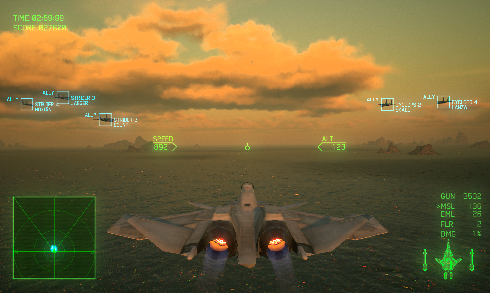
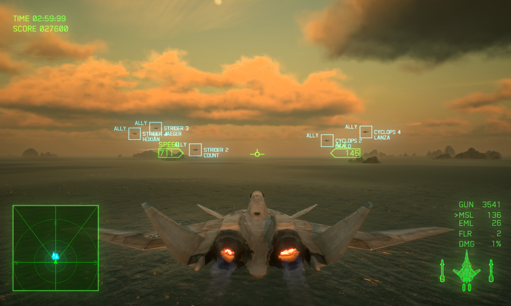

# AC7 DLSS Enhancer

English | [中文](README_zh.md)

Adds DLSS neural rendering, super resolution and frame generation to *Ace Combat 7*.

Install with [script install](#script-install) or [manual install](#manual-install).

## Preview

<table>
  <tr>
    <th>DLSS off</th>
    <th>DLSS on</th>
  </tr>
  <tr>
    <td></td>
    <td></td>
  </tr>
</table>

## How it works

The mod takes scene color, depth, motion vectors and camera parameters from the game's existing render pipeline and passes them to NVIDIA neural rendering (NR), super resolution (SR) and frame generation (FG), then returns the result to the game. When all three are enabled, the order is **NR → SR → FG**: NR first restores HDR color on the low-resolution scene, SR then reconstructs the target resolution, and after the game composites the frame, FG generates intermediate frames from game frames and their motion vectors before presentation.

NR's cost grows with the number of input pixels. Besides SR reducing the base render resolution, NR also applies non-uniform horizontal compression: the centre of the image keeps full sampling, while sampling density falls off smoothly toward both sides. NR therefore solves over a narrower working domain, and its result is mapped back to the original width before it goes to SR.

## Install

### Prerequisites

| Dependency | Notes |
| --- | --- |
| NVIDIA GeForce RTX GPU | Supported features vary by series; see the table below |
| [Ultimate ASI Loader](https://github.com/ThirteenAG/Ultimate-ASI-Loader/releases) (x64) | Loads ASI mods; install separately |
| NVIDIA DLSS SR/NR models | Included in the package under the NVIDIA SDK license |
| NVIDIA Streamline runtime libraries | Included in the package under their original licenses and third-party notices |
| NVIDIA DLSS FG runtime | Included under NVIDIA's original license terms |

Per [NVIDIA's official support table](https://www.nvidia.com/en-us/geforce/technologies/dlss/#compatibility), feature support by GPU generation is as follows. The features and maximum multiplier actually available are determined by SDK queries.

| Feature | RTX 20/30 | RTX 40 | RTX 50 |
| --- | --- | --- | --- |
| Super resolution (SR) | Supported | Supported | Supported |
| Neural rendering (NR, DLSS 5) | Not supported | Not supported | Supported |
| Frame generation (FG) | Not supported | Supported | Supported |
| Multi-frame generation / dynamic Auto | Not supported | Not supported | Supported |

**NR is currently officially supported only on RTX 50 series.**

### Script install

Run `Install.cmd`. The installer finds the Steam game folder automatically.

If the game is not found, specify the folder:

```powershell
.\Install.cmd -GameDirectory 'G:\Games\ACE COMBAT 7'
```

The installer does not overwrite existing configuration files.

### Script uninstall

Run `Uninstall.cmd` to remove the mod files and configuration added by this package.

To specify the folder:

```powershell
.\Uninstall.cmd -GameDirectory 'G:\Games\ACE COMBAT 7'
```

### Manual install

Copy these files to the game folder:

| Package content | Copy to |
|---|---|
| `payload/AC7DLSS.asi` | Game root |
| `presets/AC7DLSS.ini` | Game root |
| `payload/AC7DLSS/*.dll` | `AC7DLSS/` in the game root |

### Manual uninstall

Delete the files above.

## Usage and Settings

After installation, start the game directly.

To change settings, edit `AC7DLSS.ini` in the game folder and press **Ctrl+Shift+F11** to apply them live.

Press **Ctrl+Shift+F10** to turn the whole mod's processing on or off.

| Section | Purpose |
|---|---|
| `SuperResolution` | DLSS toggle, quality mode and sharpening |
| `NeuralRendering` | Neural rendering strength, preset and screen-edge load reduction |
| `FrameGeneration` | Frame generation toggle and multiplier |

Turning off the game's FXAA is recommended; DLSS already handles aliasing well.

`OptimizeEdges` lowers neural-rendering quality at the screen edges to reduce load.
`CenterAspectRatio` sets the proportion of the centre area kept at full quality.
`EdgeQuality`: higher values keep more edge detail.
`BlendWidth` sets the transition width.

`Multiplier` sets the frame generation multiplier. The default is Auto, which targets the game's FPS cap. `2` or higher is a fixed total multiplier that keeps the game's FPS cap. Values above the supported range fall back to the highest supported multiplier.

## Build from source

Requirements: Visual Studio 2022 (C++ tools and Windows SDK) and CMake.

External models and precompiled libraries are excluded from Git and must be supplied after cloning. Paths below are relative to the project root; SDK headers and MinHook source are already included in the repository.

| Dependency source | Destination |
| --- | --- |
| Release SR model from the [NVIDIA DLSS SDK](https://github.com/NVIDIA/DLSS); currently file version `310.9.16.0` | `third_party/models/nvngx_dlss.dll` |
| Release NR model from the [RTX Remix](https://github.com/NVIDIAGameWorks/rtx-remix) NGX/NR SDK; currently archive `rtx-remix-ngx_sdk_dlnr@2.7z`, file version `310.9.16.0` | `third_party/models/nvngx_dlssnr.dll` |
| `nvsdk_ngx_d.lib` from the same NGX/NR SDK | `third_party/ngx/lib/nvsdk_ngx_d.lib` |
| Release runtimes from `bin/x64/` in [Streamline SDK 2.14.16](https://github.com/NVIDIA-RTX/Streamline/releases/tag/v2.14.16) | `third_party/streamline/bin/x64/` |

Each component retains its original license. The build places the ASI and the runtime libraries above into `payload/`.

Run from the project root:

```powershell
powershell -NoProfile -ExecutionPolicy Bypass -File .\scripts\Build.ps1
```

Output:

```text
payload/
  AC7DLSS.asi
```

After building, deploy the output using the regular installation method.

## Credits

- [OptiScaler](https://github.com/optiscaler/OptiScaler): referenced for its D3D11/D3D12 swap-chain wrapping, shared-resource and GPU resource retirement approaches.

## License

Original project code is licensed under the [MIT License](LICENSE). Third-party code, NVIDIA models and runtime libraries retain their own licenses and are not covered by the project's MIT grant. See [third-party notices](licenses/README.md).
